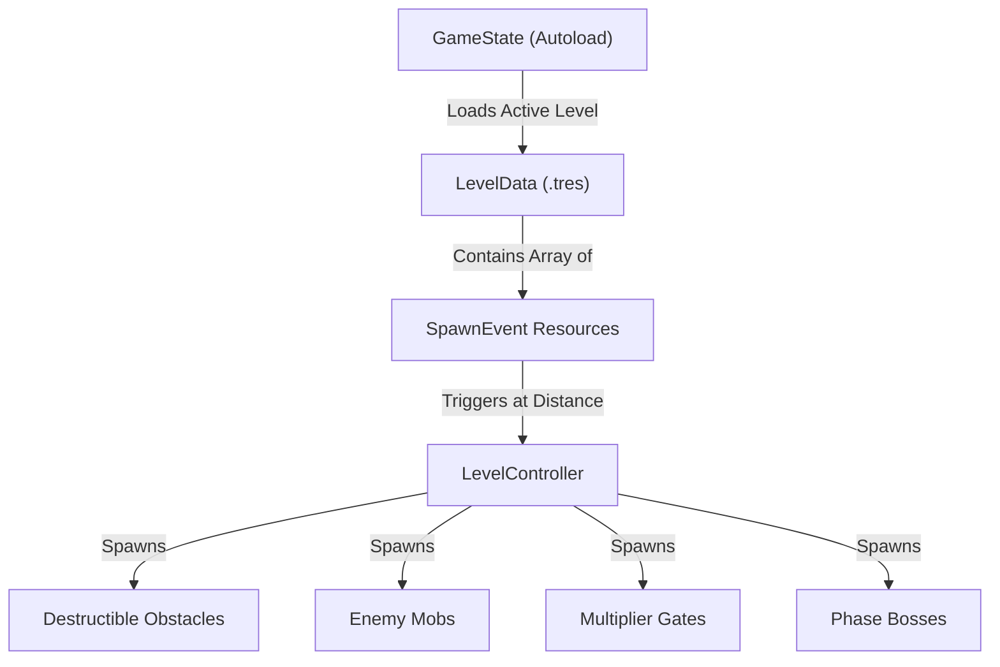

# Cove Corsair 🏴‍☠️⚓

**Cove Corsair** is a 3D pirate-themed hyper-casual runner built with **Godot 4**. It combines rapid multi-lane swerve controls with compounding multiplier gate mechanics, dynamic follower fleet accumulation, color-coded obstacle rarity tiers, a strictly deterministic wave timeline engine, and multi-phase boss encounters.

> [!NOTE]
> This repository is structured to be completely modular and fully documented for developer onboarding and AI agent integration.

---

## 📑 Table of Contents
1. [Tech Stack & System Requirements](#-tech-stack--system-requirements)
2. [Project Directory & File Structure](#-project-directory--file-structure)
3. [Core Systems & System Architecture](#-core-systems--system-architecture)
4. [Data Schemas & Resource Pipeline](#-data-schemas--resource-pipeline)
5. [Campaign Levels & Biomes Overview](#-campaign-levels--biomes-overview)
6. [How to Run, Debug, and Export](#-how-to-run-debug-and-export)
7. [Documentation Links](#-documentation-links)

---

## 🛠 Tech Stack & System Requirements

* **Game Engine:** [Godot Engine 4.x](https://godotengine.org/) (Forward+ / Mobile 3D Renderer)
* **Scripting Language:** GDScript 2.0 (Typed GDScript)
* **Target Platforms:** Android Mobile (Portrait Mode, $1080 \times 1920$ native resolution) & PC Desktop
* **Data Interchange:** Strongly-typed Godot Resources (`.tres`) and JSON configurations (`level_config.json`)

---

## 📂 Project Directory & File Structure

```
f:\projects\cove-corsair\
├── README.md                                   # Root project documentation (this file)
├── project.godot                               # Godot 4 project configuration file
├── export_presets.cfg                          # Godot Android & Desktop build export settings
├── coveCorsair.apk                             # Built Android APK package
├── assets/                                     # Audio, textures, 3D meshes, and fonts
├── documents/                                  # Strategic roadmap & technical specs
│   ├── Ahoy! Pirate Arcade Runner_...md        # Master Game Design Document & Roadmap
│   └── levels/                                 # Technical level specs per biome
│       ├── README.md                           # Level overview index
│       ├── level_01_smugglers_run.md           # Level 1 setup specification
│       ├── level_02_black_tide_bayou.md        # Level 2 setup specification
│       └── level_03_brimstone_bastion.md       # Level 3 setup specification
└── src/                                        # Core game source code
    ├── core/                                   # Global singletons, game state, camera, audio
    │   ├── game_state.gd                       # Global state autoload (score, level, progress)
    │   ├── main_game.gd / .tscn                # Main gameplay scene entrypoint
    │   ├── game_camera.gd                      # Smooth camera tracking & screen shake
    │   └── audio_manager.gd                    # Dynamic SFX & music audio bus controller
    ├── data/                                   # Data models, schemas, and resource files
    │   ├── level_data.gd                       # Strongly typed LevelData resource schema
    │   ├── spawn_event.gd                      # Strongly typed SpawnEvent resource schema
    │   ├── ship_data.gd                        # Player ship stats schema
    │   ├── weapon_data.gd                      # Weapon performance schema
    │   ├── enemy_data.gd                       # Enemy vessel & boss stats schema
    │   ├── ammo_data.gd                        # Ammunition behavior schema
    │   ├── crew_data.gd                        # Crew buff schema
    │   ├── level_config.json                   # Fallback level balancing table
    │   └── resources/                          # Compiled Godot .tres resources
    │       ├── levels/                         # level_01_smugglers_run.tres, etc.
    │       ├── user_vessels/                   # dinghy_ship.tres, sloop_ship.tres, ironclad_ship.tres
    │       ├── enemy_vessels/                  # raider_skiff.tres, skeleton_rower.tres, etc.
    │       └── enemy_bosses/                   # boss_bone_beard.tres, etc.
    ├── gameplay/                               # In-run entities and gameplay mechanics
    │   ├── levels/                             # Level execution & environment strip logic
    │   │   ├── level_controller.gd             # Scripted timeline execution engine
    │   │   ├── biome_bank_strip.gd             # Environment bank strip chunks
    │   │   ├── horizon_backdrop.gd             # Skybox quad renderer
    │   │   └── riverbank_props.gd              # Dynamic environmental props
    │   ├── player/                             # Player vessel & fleet controllers
    │   │   ├── player.gd / player_boat.tscn    # Player input, swerving, hull HP
    │   │   ├── follower_boat.gd                # Follower fleet AI formation behavior
    │   │   └── attached_weapon.gd              # Frontal/side cannon turret auto-firing logic
    │   ├── enemies/                            # Hostile mobs & boss scripts
    │   │   ├── enemy_mob.gd                    # Generic enemy mob behavior & movement
    │   │   ├── boss_war_barge.gd               # Level 1 Boss (Captain Ironjaw's War-Barge)
    │   │   ├── boss_phantom_dredge.gd          # Level 2 Boss (The Phantom Dredge)
    │   │   ├── boss_siege_fortress.gd          # Level 3 Boss (Brimstone Siege Fortress)
    │   │   └── boss_bone_beard.gd              # Alternative Boss (Captain Bonebeard)
    │   ├── obstacles/                          # Interactive track entities
    │   │   ├── destructible_obstacle.gd        # Base destructible barrel/object logic
    │   │   ├── barricade_wall.gd               # Multi-segment wooden barricade wall
    │   │   ├── multiplier_gate.gd              # Translucent multiplier arch (+, x, fleet)
    │   │   ├── hazard_sea_mine.gd              # Explosive contact mine hazard
    │   │   ├── hazard_biogas_pod.gd            # Level 2 toxic gas cloud hazard
    │   │   └── hazard_thermal_geyser.gd        # Level 3 erupting lava geyser hazard
    │   └── projectiles/                        # Cannonballs, mortars, and particle VFX
    ├── levels/                                 # World track manager
    │   ├── track_manager.gd                    # Infinite scrolling water track system
    │   ├── track_segment.gd                    # Individual track tile section
    │   └── object_calibration_sandbox.gd       # Entity balancing sandbox
    ├── shaders/                                # Custom visual shaders
    │   ├── water_stylized.gdshader             # Stylized animated 3D water shader
    │   └── stylized_foam.gdshader              # Dynamic wake foam shader
    └── ui/                                     # UI layout screens and HUD elements
        ├── top_hud.gd / .tscn                  # In-run score, progress bar, multiplier UI
        ├── start_screen.gd / .tscn             # Main menu & vessel selection screen
        ├── victory_screen.gd / .tscn           # Post-run victory summary screen
        └── end_game_ui.gd / .tscn              # Game Over summary screen
```

---

## ⚡ Core Systems & System Architecture

### 1. Global Game State (`GameState`)
Defined in [`src/core/game_state.gd`](file:///f:/projects/cove-corsair/src/core/game_state.gd), this autoload handles global signals (`doubloons_changed`, `multiplier_changed`, `progress_changed`, `boss_health_changed`), current level selection, unlocked levels, and distance tracking.

### 2. Scripted Timeline Level Engine (`LevelController`)
Defined in [`src/gameplay/levels/level_controller.gd`](file:///f:/projects/cove-corsair/src/gameplay/levels/level_controller.gd), the level controller provides **100% deterministic wave execution**. It reads arrays of [`SpawnEvent`](file:///f:/projects/cove-corsair/src/data/spawn_event.gd) objects from the active [`LevelData`](file:///f:/projects/cove-corsair/src/data/level_data.gd) resource and instantiates entities as the player reaches specified distance thresholds ($Z$ coordinates).

### 3. Player Vessel & Follower Fleet System
* **Player Boat:** ([`src/gameplay/player/player.gd`](file:///f:/projects/cove-corsair/src/gameplay/player/player.gd)) Controls touch/drag lateral movement within river bounds ($X \in [-6.0, +6.0]$), handles health/hull damage, and manages attached cannon batteries.
* **Follower Fleet:** ([`src/gameplay/player/follower_boat.gd`](file:///f:/projects/cove-corsair/src/gameplay/player/follower_boat.gd)) When passing through Fleet Summon Gates ($+1, +2$), escort skiffs spawn and maintain dynamic formation behind the player boat, adding synchronized broadside cannon volleys.

### 4. Multiplier Gate Mechanics
Defined in [`src/gameplay/obstacles/multiplier_gate.gd`](file:///f:/projects/cove-corsair/src/gameplay/obstacles/multiplier_gate.gd), translucent arches drift along lanes. 
* **Cannonball Gates ($+N, \times N$):** Broadside volleys passing through gates duplicate or multiply cannonball density.
* **Fleet Summon Gates ($+N$):** Passing the player ship through the gate summons additional follower skiffs.

### 5. Multi-Phase Boss Battles
Each campaign level culminates in a custom boss battle:
* **Level 1 Boss:** [Captain Ironjaw's War-Barge](file:///f:/projects/cove-corsair/src/gameplay/enemies/boss_war_barge.gd) ($220\text{ HP}$) with destructible swivel guns and exposed boiler core.
* **Level 2 Boss:** [The Phantom Dredge](file:///f:/projects/cove-corsair/src/gameplay/enemies/boss_phantom_dredge.gd) ($750\text{ HP}$) with ghost submersion and toxic shockwave attacks.
* **Level 3 Boss:** [Brimstone Siege Fortress](file:///f:/projects/cove-corsair/src/gameplay/enemies/boss_siege_fortress.gd) ($800\text{ HP}$) with mortar turrets, magma vents, and exposed core meltdown phases.

---

## 📊 Data Schemas & Resource Pipeline

Level generation and entity stats rely on strongly-typed Godot Resource classes:



* **`LevelData`** ([`src/data/level_data.gd`](file:///f:/projects/cove-corsair/src/data/level_data.gd)): Defines level identity, target distance, starting vessel archetype, environment water/fog colors, scroll speed, and timeline spawn events.
* **`SpawnEvent`** ([`src/data/spawn_event.gd`](file:///f:/projects/cove-corsair/src/data/spawn_event.gd)): Defines distance trigger ($Z$), entity type (barrel, mob, gate, hazard, boss), lane position ($X$), rarity tier, HP override, and gate parameters.
* **`ShipData`** ([`src/data/ship_data.gd`](file:///f:/projects/cove-corsair/src/data/ship_data.gd)): Defines vessel max health, speed, handling acceleration, and weapon mounting slots.

---

## 🏝 Campaign Levels & Biomes Overview

| Level ID | Level Name | Biome Type | Target Distance | Scroll Speed | Starting Vessel | Boss Encounter | Setup Document |
| :--- | :--- | :--- | :--- | :--- | :--- | :--- | :--- |
| **Level 1** | Smuggler's Run | `smugglers_run` | $250\text{m}$ | $10.0\text{ m/s}$ | The Dinghy | War-Barge ($220\text{ HP}$) | [Level 1 Setup Spec](file:///f:/projects/cove-corsair/documents/levels/level_01_smugglers_run.md) |
| **Level 2** | Black Tide Bayou | `black_tide_bayou` | $280\text{m}$ | $10.0\text{ m/s}$ | The Sloop | Phantom Dredge ($750\text{ HP}$) | [Level 2 Setup Spec](file:///f:/projects/cove-corsair/documents/levels/level_02_black_tide_bayou.md) |
| **Level 3** | Brimstone Bastion | `brimstone_bastion` | $320\text{m}$ | $10.0\text{ m/s}$ | The Ironclad | Siege Fortress ($800\text{ HP}$) | [Level 3 Setup Spec](file:///f:/projects/cove-corsair/documents/levels/level_03_brimstone_bastion.md) |

---

## 🚀 How to Run, Debug, and Export

### 1. Opening in Godot Engine 4
1. Launch **Godot 4.x**.
2. Click **Import** and select `f:\projects\cove-corsair\project.godot`.
3. Press **Play (F5)** or open [`src/core/main_game.tscn`](file:///f:/projects/cove-corsair/src/core/main_game.tscn).

### 2. Running via Command Line
```bash
# Run main gameplay scene in Godot 4
godot --scene src/core/main_game.tscn
```

### 3. Building & Exporting Android APK
The project includes export settings configured in [`export_presets.cfg`](file:///f:/projects/cove-corsair/export_presets.cfg).
```bash
# Export release Android APK
godot --headless --export-release "Android" coveCorsair.apk
```

---

## 📚 Documentation Links

* 📑 **Master Game Design & Strategic Roadmap:** [`documents/Ahoy! Pirate Arcade Runner_ Master Game Design & Strategic Roadmap.md`](file:///f:/projects/cove-corsair/documents/Ahoy%21%20Pirate%20Arcade%20Runner_%20Master%20Game%20Design%20&%20Strategic%20Roadmap.md)
* ⛵ **Vessels & Mobs Specification:** [`documents/vessels.md`](file:///f:/projects/cove-corsair/documents/vessels.md)
* 🐒 **Deck Crew & Weapon Mounts Specification:** [`documents/crew.md`](file:///f:/projects/cove-corsair/documents/crew.md)
* 💣 **Ammunition & Projectile Specification:** [`documents/ammo.md`](file:///f:/projects/cove-corsair/documents/ammo.md)
* 🛢️ **Lane Objects, Hazards & Gates Specification:** [`documents/lane_objects.md`](file:///f:/projects/cove-corsair/documents/lane_objects.md)
* 🗺️ **Level Systems Overview Index:** [`documents/levels/README.md`](file:///f:/projects/cove-corsair/documents/levels/README.md)
  * 📜 **Level 1 Setup Specification:** [`documents/levels/level_01_smugglers_run.md`](file:///f:/projects/cove-corsair/documents/levels/level_01_smugglers_run.md)
  * 📜 **Level 2 Setup Specification:** [`documents/levels/level_02_black_tide_bayou.md`](file:///f:/projects/cove-corsair/documents/levels/level_02_black_tide_bayou.md)
  * 📜 **Level 3 Setup Specification:** [`documents/levels/level_03_brimstone_bastion.md`](file:///f:/projects/cove-corsair/documents/levels/level_03_brimstone_bastion.md)

