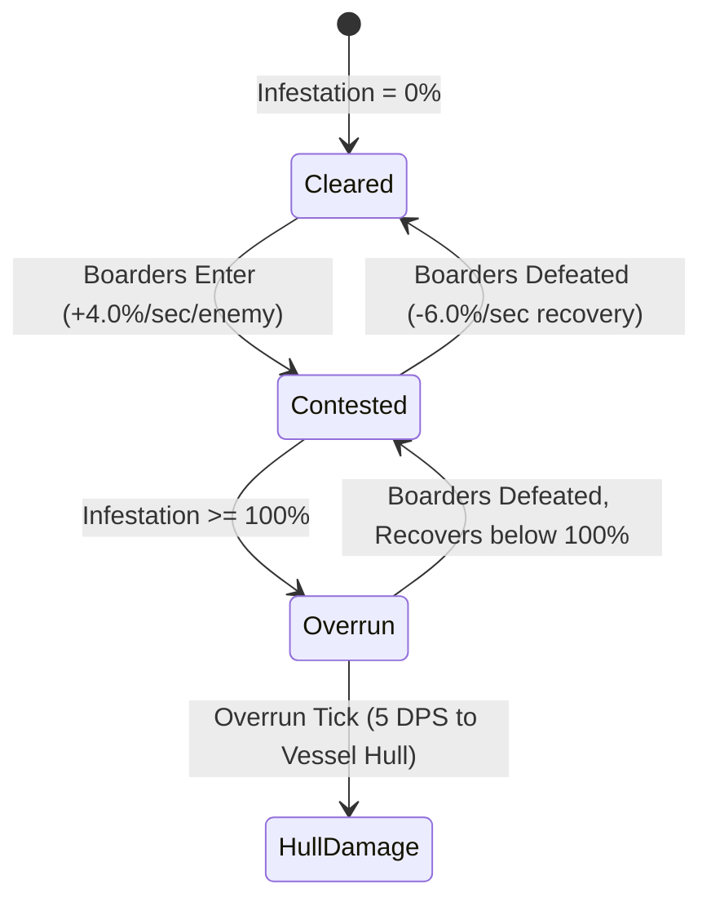
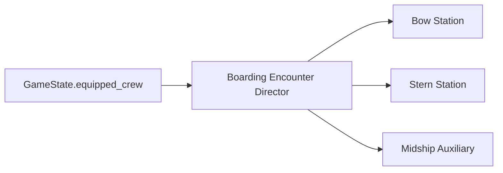

# Cove Corsair: 3-Zone Deck Defense Boarding System
## Comprehensive Game Design & Technical Architecture Document

---

## 🏴‍☠️ 1. Executive Summary & Gameplay Vision

### 1.1 Premise
When an enemy vessel (such as a Marauder Raider, Crimson Gunner, or Boss War-Barge) pulls alongside the player's flagship, the encounter shifts dynamically into **Boarding Defense**. Hostile pirate swarms fling grapple hooks across the gunwales, securing ropes to latch onto the player vessel. Boarders rapidly scale these lines to swarm the deck.

The player and their ship's crew must defend the vessel across three distinct sectors (**Bow**, **Midship**, **Stern**). If boarders overwhelm a zone, the sector becomes **Overrun**, disabling friendly crew buffs and inflicting direct damage to the flagship's hull.

```text
       ENEMY BOARDING VESSEL (Parallels Starboard or Port)
       [ Grapple Winch ]       [ Grapple Winch ]       [ Grapple Winch ]
              │                       │                       │
         (Rope Hook)             (Rope Hook)             (Rope Hook)
              ▼                       ▼                       ▼
     ┌─────────────────┬─────────────────────┬─────────────────┐
     │  ZONE A: BOW    │   ZONE B: MIDSHIP   │  ZONE C: STERN  │
     │                 │                     │                 │
     │  Grapple Anchor │   Grapple Anchor    │  Grapple Anchor │
     │  Infestation Bar│   Infestation Bar   │  Infestation Bar│
     │  Station: Crew 1│   Station: Player   │  Station: Crew 2│
     └─────────────────┴─────────────────────┴─────────────────┘
                                ▲
                                │
               [SHIP HEALTH & INFESTATION DIRECTOR]
```

### 1.2 Core Pillars
1. **Tactile & Responsive (Mobile & Desktop First):** Tapping or clicking a zone instantly snaps the player to that sector's defense station, avoiding clumsy joystick navigation across narrow gangways. Direct clicks on ropes or enemies trigger immediate weapon fire.
2. **Meaningful Crew Synergy:** Player-owned crew unlocked in the Shipyard (`monkey_bomber`, `skeleton_tosser`, `deckhand_sniper`, `grease_monkey`) take defensive stations, applying their unique combat roles automatically.
3. **High-Stakes Priority Juggling:** Players must choose between cutting grapple ropes early to drop entire climbing swarms into the sea or engaging boarders already hacking at ship rigging.
4. **Decoupled Godot 4 Architecture:** Completely isolated nodes communicating via strictly typed signals, adhering to zero untyped warnings.

---

## ⚔️ 2. Core Mechanics Breakdown

### 2.1 The 3 Deck Zones (Bow, Midship, Stern)
The deck is partitioned into three discrete `Area3D` bounding volumes:
* **Bow (Prow):** Narrow forward zone. Vulnerable to fast grapple assaults.
* **Midship (Main Deck):** Central wide zone containing the main mast and primary player station.
* **Stern (Quarterdeck):** Elevated aft zone near the ship's helm and captain's quarters.

Each zone tracks:
* `active_boarders: Array[Node3D]`: Enemies currently standing on deck inside the zone's volume.
* `active_grapples: Array[Node3D]`: Grapple lines currently latched to this zone's anchor marker.
* `current_infestation: float` ($0.0$ to $100.0$): Infestation pressure.
* `is_overrun: bool`: True when infestation reaches $100\%$.

### 2.2 Infestation & Overrun State Machine


1. **Infestation Accumulation:** Every active boarder inside a zone adds $+4.0\%/\text{second}$.
2. **Passive Recovery:** When a zone has 0 active boarders, it recovers at $-6.0\%/\text{second}$ until reaching $0\%$.
3. **Overrun Consequences:**
   * Direct hull damage: Deals $5.0 \text{ damage/sec}$ directly to the flagship's `current_health`.
   * Crew suppression: Crew stationed in that zone are knocked down or disabled until infestation drops below $80\%$.
   * Visual/Audio alerts: Red warning beacon, siren sound, and hull smoke.

### 2.3 Grapple Ropes & Swarm Climbers
* **Rope Mechanics (`BoardingGrappleRope`):**
  * Spans from an enemy winch marker to the zone's `grapple_anchor` (`Marker3D`).
  * Features a parabolic catenary sag: $Y_{sag} = \sin(\text{progress} \cdot \pi) \cdot 0.45\text{m}$.
  * Has a destructible health pool (`max_health = 30.0`).
  * When severed: All climbers currently travelling on that rope lose tracking and tumble into the ocean with splash VFX.
* **Boarder Units (`BoarderEnemy`):**
  * **Climb Phase:** Interpolates along the rope path from $0.0 \to 1.0$ over `climb_duration_sec` ($3.5\text{s}$).
  * **Deck Combat Phase:** Upon reaching $1.0$, drops onto deck, joins the zone's `active_boarders`, and scrambles to damage rigging and raise infestation.
  * **Overboard Fall:** If the rope is severed while $0.0 \le \text{progress} < 1.0$, the enemy enters ragdoll/tween fall: drops $-4.0\text{m}$ in Y with rotation and despawns upon water contact.

---

## 🎯 3. Player Combat & Control System

### 3.1 Input & Targeting Architecture (`DeckTargetingSystem`)
The targeting system processes screen taps (`InputEventScreenTouch`) and mouse clicks (`InputEventMouseButton`):
1. **Raycast Query:** Casts a physics ray from camera coordinates against collision masks for:
   * Enemies (Layer 2)
   * Grapple Ropes (Layer 3)
   * Deck Zones / Ground (Layer 0)
2. **Priority Resolution:**
   * **Direct Hit on Enemy or Rope:** Reticle locks onto entity $\to$ fires primary weapon (or secondary if held/selected).
   * **Hit on Deck Zone:** Player avatar jogs to that zone's barricade station $\to$ auto-targets highest threat in that zone (Grapple Rope > Closest Boarder).
   * **Hit on Water / Void:** No action.

### 3.2 Weapon Arsenal

| Weapon | Trigger / Input | Damage | Cooldown | Targeting Behavior | Game Feel & VFX |
| :--- | :--- | :--- | :--- | :--- | :--- |
| **Blunderbuss** | Quick Tap / Click | $18.0$ (Conical AoE) | $0.60\text{s}$ | Fires $35^\circ$ forward cone up to $8.0\text{m}$; cleaves multiple boarders | Smoke puff, pellet trails, audio blast, camera shudder |
| **Heavy Breaker Shot / Grapnel Axe** | Heavy Tap / Long Press / Right Click | $35.0$ (Single Target) | $2.50\text{s}$ | Precision shot; instantly severs grapple ropes ($30 \text{ HP}$) or deals $2\times$ damage to heavy boarders | Heavy thwack audio, rope snap particle burst, high screen trauma |

### 3.3 Movement & Orientation (`DeckPlayerController`)
* When ordered to a zone station, the player navigates to `target_station_position` at $8.0\text{ m/s}$.
* Smoothly slerps torso/facing angle toward active target or cursor coordinate ($14.0 \cdot \Delta t$).

---

## 🐒 4. Shipyard Crew Member Integration (Ground Truth Roster)

Rather than fictional placeholders, the system binds directly to the player's equipped crew from `GameState.equipped_crew`:



### 4.1 Crew Roles & Automated Behaviors

| Crew Resource | In-Game Name | Deck Station Role | Automated Deck Behavior |
| :--- | :--- | :--- | :--- |
| [`crew_monkey_bomber.tres`](file:///f:/projects/cove-corsair/src/data/resources/user_crew/crew_monkey_bomber.tres) | **Monkey Bomber** | **Swarm Suppression** | Scans all zones. When any zone infestation exceeds $35\%$, lobs Coconut/Fire Bombs into the densest cluster, dealing AoE splash damage ($5 \text{ DMG}$). |
| [`weapon_deckhand_sniper.tres`](file:///f:/projects/cove-corsair/src/data/resources/user_crew/weapon_deckhand_sniper.tres) | **Deckhand Sniper** | **Rope Sabotage** | Operates from high rigging/crow's nest. Every $3.5\text{s}$, fires an armor-piercing round at the nearest attached grapple rope, dealing $30 \text{ DMG}$ to sever it instantly. |
| [`crew_skeleton_tosser.tres`](file:///f:/projects/cove-corsair/src/data/resources/user_crew/crew_skeleton_tosser.tres) | **Skeleton Fire Tosser** | **Gangway Denial** | Hurls fire pots at grapple anchor points when ropes latch. Creates a $2.5\text{m}$ lingering flame ring that burns boarders landing on deck. |
| [`crew_grease_monkey.tres`](file:///f:/projects/cove-corsair/src/data/resources/user_crew/crew_grease_monkey.tres) | **Grease Monkey** | **Deck Damage Control** | Stationed midship. Increases passive zone recovery by $+50\%$ and rapidly extinguishes hazards, reducing vessel hull attrition by $40\%$. |

*If a player enters boarding without crew equipped in certain sockets, basic autonomous Deckhands with baseline blunderbuss rifles fill unassigned stations.*

---

## 🏗️ 5. Scene Architecture & Hierarchy

All boarding assets are isolated under `src/features/boarding/`:

```text
res://src/features/boarding/
├── boarding_defense_arena.tscn         # Root encounter coordinator & enemy vessel
├── boarding_defense_arena.gd
├── boarding_zone.tscn                  # Modular 3-zone Area3D with anchors & infestation
├── boarding_zone.gd
├── boarding_grapple_rope.tscn          # Catenary rope visual & severable health component
├── boarding_grapple_rope.gd
├── boarder_enemy.tscn                  # Climbing / deck combat swarmer unit
├── boarder_enemy.gd
├── player/
│   ├── deck_player_controller.tscn    # Player avatar with blunderbuss & axe
│   ├── deck_player_controller.gd
│   ├── deck_targeting_system.gd       # Raycasting, sector selection & priority
│   └── deck_reticle_3d.tscn           # Visual targeting ring
│       └── deck_reticle_3d.gd
├── crew/
│   ├── boarding_crew_station.tscn     # Crew slot wrapper node
│   └── boarding_crew_station.gd       # Autonomous targeting & behavior dispatch
└── ui/
    ├── boarding_hud.tscn              # Top/bottom tactical overlay (Infestation bars)
    └── boarding_hud.gd
```

---

## 🔌 6. Engine & Game Integration Points

### 6.1 Triggering the Encounter
A boarding encounter can occur in three primary contexts:
1. **Endless Mode Random Ambush:** When reaching distance milestones, an enemy raider draws broadside and grapples the player.
2. **Campaign Boss Phase (e.g., Ironjaw War-Barge or Bonebeard):** During Phase 2 of a boss fight, the boss locks alongside and initiates boarding waves before becoming vulnerable to cannon fire.
3. **Dedicated Extraction Minigame / Sandbox:** Direct launch via test harness or hub mission board.

### 6.2 Flagship Health Routing
* Hull damage routes directly to the active `PlayerSwerve` instance if present, or calls `GameState.record_hit()` and emits `EventBus.player_hit_taken`.
* If flagship health reaches $0$, standard game over (`player_sunk`) is triggered.

### 6.3 Victory Conditions
* **Wave Cleared:** Successfully surviving all boarding waves and severing all grapples causes the enemy vessel to disengage or explode.
* **Doubloon Payout:** Bonus plunder awarded based on ropes severed and boarders defeated without letting any zone reach Overrun.

---

## 📋 7. Production Roadmap & Verification

1. **Step 1: Core Framework & Test Sandbox**
   * Build `boarding_zone.gd`, `boarding_grapple_rope.gd`, and `boarder_enemy.gd`.
   * Create an automated unit/integration test harness `test_boarding_defense.gd` to verify rope traversal, severing, infestation ticking, and overrun signaling.
2. **Step 2: Player Controller & Targeting System**
   * Implement `DeckPlayerController` and `DeckTargetingSystem` with blunderbuss cone and heavy axe breaker.
   * Add 3D visual reticle ring and station movement.
3. **Step 3: Crew Station Automation**
   * Implement `BoardingCrewStation` binding to `monkey_bomber`, `deckhand_sniper`, `skeleton_tosser`, and `grease_monkey`.
4. **Step 4: Encounter Director & Visual/Audio Polish**
   * Assemble `boarding_defense_arena.tscn` with 3 zones and broadside enemy vessel.
   * Integrate 3D models (`the_sloop.glb`, `monkey_crew.glb`, `skeleton_crew.glb`, `ship-pirate-medium.glb`).
   * Hook up sound cues (rope snap, blunderbuss blast, siren) and particle effects.
