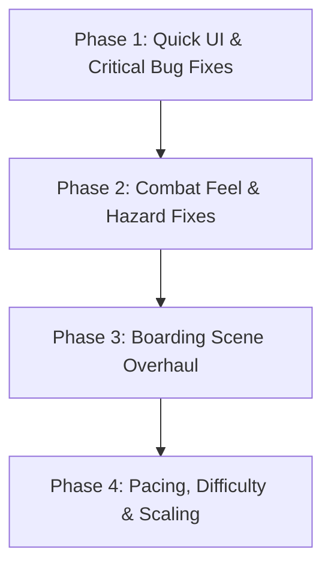

# Cove Corsair — Campaign Playtest Fix Plan & Roadmap
**Document Reference**: `CAMPAIGN_PLAYTEST_FIX_PLAN.md`  
**Date**: 2026-09-30  
**Context**: Post-campaign playtest review (Sessions 171 & 172, Levels 1–45 + Endless)

---

## 1. Executive Summary

During the full campaign playtest across Levels 1–45 and Endless runs, 11 distinct gameplay, boarding, and UI/navigation issues were identified, alongside key pacing insights extracted from run telemetry (771 mob kills, 146,582 fired rounds).

This document breaks down every item into actionable technical tasks, groups them logically into implementation milestones, identifies exact files and functions to modify, and lays out a proposed execution sequence for review before coding begins.

---

## 2. Issues Breakdown & Proposed Solutions

### Group A: Boarding Defense System
The boarding mini-game is a signature encounter during boss fights, but currently suffers from static setup, visual mismatches, and premature triggering.

---

#### Item 1: Boarding Trigger at ~2% Boss HP (Issue #9)
* **Problem**: In-run boarding currently triggers as soon as the boss appears or at fixed initial arrival, interrupting the boss naval combat before the player actually fights the vessel.
* **Intended Behavior**: The boss fight should play out on the water. When the boss vessel drops to critical health (**~2% HP** or upon reaching the fatal threshold), the boss initiates a desperate last-stand boarding action.
* **Root Cause**: `in_run_boarding_adapter.gd` hooks into the boss encounter initiation rather than monitoring boss health.
* **Files Involved**:
  * [`src/features/boarding/in_run_boarding_adapter.gd`](file:///f:/projects/cove-corsair/src/features/boarding/in_run_boarding_adapter.gd)
  * [`src/features/tracks/chunks/chunk_boss_base.gd`](file:///f:/projects/cove-corsair/src/features/tracks/chunks/chunk_boss_base.gd) (or specific boss chunk scripts)
* **Proposed Fix**:
  * Connect to boss vessel's `health_changed(current_hp, max_hp)` signal.
  * Trigger `start_in_run_boarding()` only when `float(current_hp) / float(max_hp) <= 0.02` (or on lethal hit if 2% is bypassed in one shot).
  * Pause naval combat and transition camera smoothly into the boarding scene.

---

#### Item 2: Selected Player Vessel Model in Boarding Scene (Issue #6)
* **Problem**: The player vessel in the boarding arena always renders as the starter Dinghy, regardless of whether the player is piloting a Sloop, Bombard, or Ironclad.
* **Root Cause**: `in_run_boarding_adapter.gd` passes the enemy vessel type to `setup_enemy_vessel()` on the boarding arena, but never instructs the arena to instantiate or swap the player's active vessel mesh/chassis.
* **Files Involved**:
  * [`src/features/boarding/boarding_defense_arena.gd`](file:///f:/projects/cove-corsair/src/features/boarding/boarding_defense_arena.gd)
  * [`src/features/boarding/boarding_defense_arena.tscn`](file:///f:/projects/cove-corsair/src/features/boarding/boarding_defense_arena.tscn)
  * [`src/features/boarding/in_run_boarding_adapter.gd`](file:///f:/projects/cove-corsair/src/features/boarding/in_run_boarding_adapter.gd)
* **Proposed Fix**:
  * Read `GameState.active_vessel_id` in `in_run_boarding_adapter.gd` and pass it into `boarding_defense_arena.setup_player_vessel(vessel_id: String)`.
  * In `boarding_defense_arena.gd`, dynamically load/show the matching player deck model and align deck boundaries accordingly.

---

#### Item 3: Plank Alignment & Anchor Offsets for All Vessels/Bosses (Issue #2)
* **Problem**: On Boss 2 (and other non-standard hull sizes), the boarding gangplanks do not connect to the ship bulwarks properly—planks float in mid-air or clip into the enemy hull.
* **Root Cause**: Plank transform anchors are hardcoded to fixed static Vector3 coordinates in `boarding_defense_arena.tscn`, assuming a single fixed hull width and length.
* **Files Involved**:
  * [`src/features/boarding/boarding_defense_arena.gd`](file:///f:/projects/cove-corsair/src/features/boarding/boarding_defense_arena.gd)
  * [`src/features/boarding/boarding_defense_arena.tscn`](file:///f:/projects/cove-corsair/src/features/boarding/boarding_defense_arena.tscn)
* **Proposed Fix**:
  * Define model-specific deck/gunwale anchor dictionaries for each vessel type (Player: Dinghy, Sloop, Bombard, Ironclad; Enemies: Raider, Frigate, Boss 1, Boss 2, Boss 3).
  * When `setup_player_vessel()` and `setup_enemy_vessel()` run, reposition the plank meshes and their navigation/walking paths to snap between the player's starboard gunwale and enemy's port gunwale.

---

#### Item 4: Empty Crew Slot Handling & Special Attacks (Issue #8)
* **Problem**: If the player enters a boarding scene without an assigned crew member, the deck still displays the sniper crew model, and crew special attacks remain active.
* **Root Cause**: `boarding_defense_arena.gd:_setup_crew_from_gamestate()` falls back to a hardcoded default `"deckhand_sniper"` whenever `equipped_crew` is empty or null.
* **Files Involved**:
  * [`src/features/boarding/boarding_defense_arena.gd`](file:///f:/projects/cove-corsair/src/features/boarding/boarding_defense_arena.gd)
* **Proposed Fix**:
  * If `GameState.get_equipped_crew()` is empty:
    * Hide crew visual node completely (`crew_model.visible = false`).
    * Disable special attack button on the HUD.
    * Restrict player to basic defense actions only (cutlass/pistol).

---

#### Item 5: Dynamic Boarding Difficulty & Mob Scaling (Issue #3)
* **Problem**: Boarding defense currently features identical difficulty across the entire game (always 3 waves, 8-second intervals, 1–2 mobs per wave).
* **Intended Behavior**: Boarding difficulty should scale with world/level tier: higher-level bosses send tougher boarding parties (more raiders, tankier elite mobs, shorter wave delays).
* **Files Involved**:
  * [`src/features/boarding/boarding_defense_arena.gd`](file:///f:/projects/cove-corsair/src/features/boarding/boarding_defense_arena.gd)
  * [`src/features/boarding/in_run_boarding_adapter.gd`](file:///f:/projects/cove-corsair/src/features/boarding/in_run_boarding_adapter.gd)
* **Proposed Fix**:
  * Pass current campaign level or boss tier into `setup_encounter_difficulty(level_index: int)`.
  * Scale:
    * `wave_count` (e.g., 2 waves on early levels, 3–4 on mid, 4–5 on late/boss tiers).
    * `mobs_per_wave` and mob composition (mix in armored boarders or bombers on later levels).
    * Spawn cadence adjusted by tier.

---

### Group B: UI, Navigation & Progression UX

---

#### Item 6: Victory / Defeat Screen "Level Map" Button Route (Issue #4)
* **Problem**: Clicking "Level Map" on the victory or defeat screens redirects the player to the Main Menu / Home page instead of the Level Map screen.
* **Root Cause**: Button signal callback loads `res://src/ui/screens/main_menu.tscn` instead of the campaign map scene `res://src/ui/screens/level_select.tscn` (or equivalent map route).
* **Files Involved**:
  * [`src/ui/screens/settlement_screen.gd`](file:///f:/projects/cove-corsair/src/ui/screens/settlement_screen.gd) / `victory_screen.gd` / `game_over_screen.gd`
* **Proposed Fix**:
  * Update the button pressed handler to transition directly to `SceneRouter.goto_level_select()` / `res://src/ui/screens/level_select.tscn`.

---

#### Item 7: "Map Complete" Button Restarts Last Level (Issue #11)
* **Problem**: Upon clearing the final level or completing a sector map, the confirmation button replays the level just cleared instead of returning to the map or advancing.
* **Root Cause**: Scene reload logic invokes `get_tree().reload_current_scene()` or passes `current_level_id` instead of checking if the next level exists or routing back to map view.
* **Files Involved**:
  * [`src/ui/screens/settlement_screen.gd`](file:///f:/projects/cove-corsair/src/ui/screens/settlement_screen.gd)
* **Proposed Fix**:
  * Check if next level is available; if yes, offer "Next Level" (`level_id + 1`). If campaign sector is finished, button should say "Return to Map" and navigate to `level_select.tscn`.

---

#### Item 8: Sloop Progression Nudge — Endless Farming Prompt (Issue #1)
* **Problem**: When the player unlocks and equips the Sloop, difficulty ramps up sharply. Players get stuck without knowing they can farm Endless Mode for gold to buy hull/cannon upgrades.
* **Intended Behavior**: Add an in-game UX hint or popup when the Sloop is first equipped or after consecutive defeats on early Sloop levels, encouraging the player to visit Endless Mode for upgrade coin.
* **Files Involved**:
  * [`src/ui/screens/level_select.gd`](file:///f:/projects/cove-corsair/src/ui/screens/level_select.gd) or [`src/features/settlement/settlement_screen.gd`](file:///f:/projects/cove-corsair/src/features/settlement/settlement_screen.gd)
  * [`src/core/state/game_state.gd`](file:///f:/projects/cove-corsair/src/core/state/game_state.gd)
* **Proposed Fix**:
  * Track first defeat with Sloop without adequate upgrades; present a clean banner/tip: *"Tip: Waters ahead are perilous! Venture into Endless Voyage to gather gold and reinforce your Sloop's hull and cannons."* with a direct "Sail Endless" shortcut button.

---

### Group C: Core Naval Gameplay, Hazards & Physics

---

#### Item 9: Bombard Screen Shake Dampening (Issue #7)
* **Problem**: Firing the Bombard causes excessive, disorienting camera shaking that makes combat unreadable.
* **Root Cause**: In `cannonball.gd:652`, `_apply_splash_damage()` executes `CameraShake.add_trauma(0.45)` for *each* entity struck in the blast radius. A 3-enemy group hit applies `0.45 * 3 = 1.35` trauma in a single frame.
* **Files Involved**:
  * [`src/features/combat/cannonball.gd`](file:///f:/projects/cove-corsair/src/features/combat/cannonball.gd)
* **Proposed Fix**:
  * Cap splash trauma so it only applies *once* per explosion event (e.g., `0.20` max), regardless of how many targets are caught in the blast radius.
  * Expose a trauma scale multiplier in the cannon configuration so heavy mortar fire feels punchy without violent jitter.

---

#### Item 10: Endless Boss Ramming & Fleet Wipeout (Issue #5)
* **Problem**: In Endless Mode, when the boss ship spawns, it continues advancing forward along the track, passing directly through the player's vessel and repeatedly triggering collision damage until the player is destroyed.
* **Root Cause**: Boss AI in Endless Mode lacks a forward stopping distance / standoff constraint relative to the player, or the track chunk does not lock the boss's Z-position at the standoff anchor.
* **Files Involved**:
  * [`src/features/tracks/chunks/chunk_boss_base.gd`](file:///f:/projects/cove-corsair/src/features/tracks/chunks/chunk_boss_base.gd)
  * Boss navigation/movement controllers (e.g., `enemy_ship.gd`, `boss_controller.gd`)
* **Proposed Fix**:
  * Enforce minimum standoff distance (e.g., 18–22m ahead of player).
  * Prevent boss movement controller from stepping past the standoff boundary along the Z-axis.
  * Add collision response safeguard to avoid continuous per-frame overlapping contact damage.

---

#### Item 11: Level 32+ Red/Orange Lane Hazards Not Damaging (Issue #10)
* **Problem**: Red/orange warning circles that appear on lanes at Level 32+ (whirlpools, thermal vents, or geysers) show visuals but deal zero damage when the player sails over them.
* **Telemetry Evidence**: In all 46 playtest runs, damage from environmental hazards was 0.
* **Files Involved**:
  * [`src/features/hazards/hazard_whirlpool.gd`](file:///f:/projects/cove-corsair/src/features/hazards/hazard_whirlpool.gd)
  * [`src/features/hazards/hazard_thermal_geyser.gd`](file:///f:/projects/cove-corsair/src/features/hazards/hazard_thermal_geyser.gd)
  * Collision layer masks on hazard `Area3D` nodes.
* **Proposed Fix**:
  * Inspect collision layers: ensure hazard `Area3D` monitors the layer where the player vessel's hurtbox resides (Collision Layer 2 / Player Layer).
  * Verify `_on_body_entered` / `_on_area_entered` triggers damage application and is not blocked by missing group tags.

---

### Group D: Pacing & Telemetry Polish (From Session 171/172 Telemetry)

---

#### Item 12: Barricade Destruction Telemetry Fix (Telemetry Finding)
* **Problem**: Playtest logs recorded 0 barricades destroyed despite barricade siege chunks appearing in every run.
* **Root Cause**: `BarricadeSegment` in `destructible_obstacle.gd` overrides `die()` without calling `super.die()`, omitting the `EventBus.obstacle_destroyed_telemetry` signal.
* **Files Involved**:
  * [`src/features/obstacles/destructible_obstacle.gd`](file:///f:/projects/cove-corsair/src/features/obstacles/destructible_obstacle.gd)
* **Proposed Fix**: Add `super.die()` in `BarricadeSegment.die()`.

---

#### Item 13: Combat Downtime & Engagement Range Alignment (Telemetry Finding)
* **Problem**: Cannons fire out to `max_range = 38m`, but all mob kills occur within 21–24m. Over 146,000 cannonballs are fired into empty water, creating the impression of dead time and empty levels.
* **Files Involved**:
  * Cannon resource configurations (`res://src/data/weapons/...`)
  * `cannonball.gd` / mob spawn distances
* **Proposed Fix**:
  * Align cannon effective range and projectile lifetime with visual fog/draw distance.
  * Tighten mob spawn-to-engagement window so mobs become targetable sooner after appearing on screen.

---

## 3. Recommended Phased Implementation Roadmap

To maintain stability and enable testing after each step, we recommend tackling these issues in 4 sequential phases:

### Phase 1: High-Impact UI & Navigation Fixes (Items 4, 6, 7, 12)
* **Goal**: Eliminate broken navigation loops and fix blind telemetry spots.
* **Tasks**:
  1. Fix "Level Map" button redirecting to main menu instead of level map.
  2. Fix "Map Complete" button restarting the last level.
  3. Fix `BarricadeSegment.die()` telemetry omission.
* **Deliverable**: Clean flow between gameplay and map; accurate telemetry.

### Phase 2: Core Combat & Hazard Integrity (Items 7, 9, 10, 11)
* **Goal**: Fix combat readability and restore challenge in high-level runs.
* **Tasks**:
  1. Dampen Bombard splash camera shake trauma stack.
  2. Implement Endless Boss standoff clamp to stop ship ramming.
  3. Fix collision layers and damage triggers on L32+ orange/red lane hazards.
* **Deliverable**: Smooth Bombard combat, functional late-game hazards, safe Endless boss encounters.

### Phase 3: Complete Boarding Scene Overhaul (Items 1, 2, 3, 4, 8)
* **Goal**: Deliver a polished, consistent boarding experience matching all vessels.
* **Tasks**:
  1. Move boarding initiation to ~2% boss health trigger.
  2. Swap player vessel model in boarding arena based on active vessel.
  3. Calculate dynamic gangplank offsets for each boss and vessel pair.
  4. Properly hide crew model and disable abilities when no crew is equipped.
* **Deliverable**: Seamless, thematic boarding sequence with correct visual assets.

### Phase 4: Pacing, Progression & Scaling (Items 3, 5, 8, 13)
* **Goal**: Smooth the early-game Sloop difficulty curve and eliminate mid-level downtime.
* **Tasks**:
  1. Implement Sloop Endless farming UX prompt.
  2. Add dynamic boarding wave and mob scaling by level tier.
  3. Tune cannon range and mob engagement cadence to reduce wasted fire.
* **Deliverable**: Balanced progression and active, engaging naval combat.
