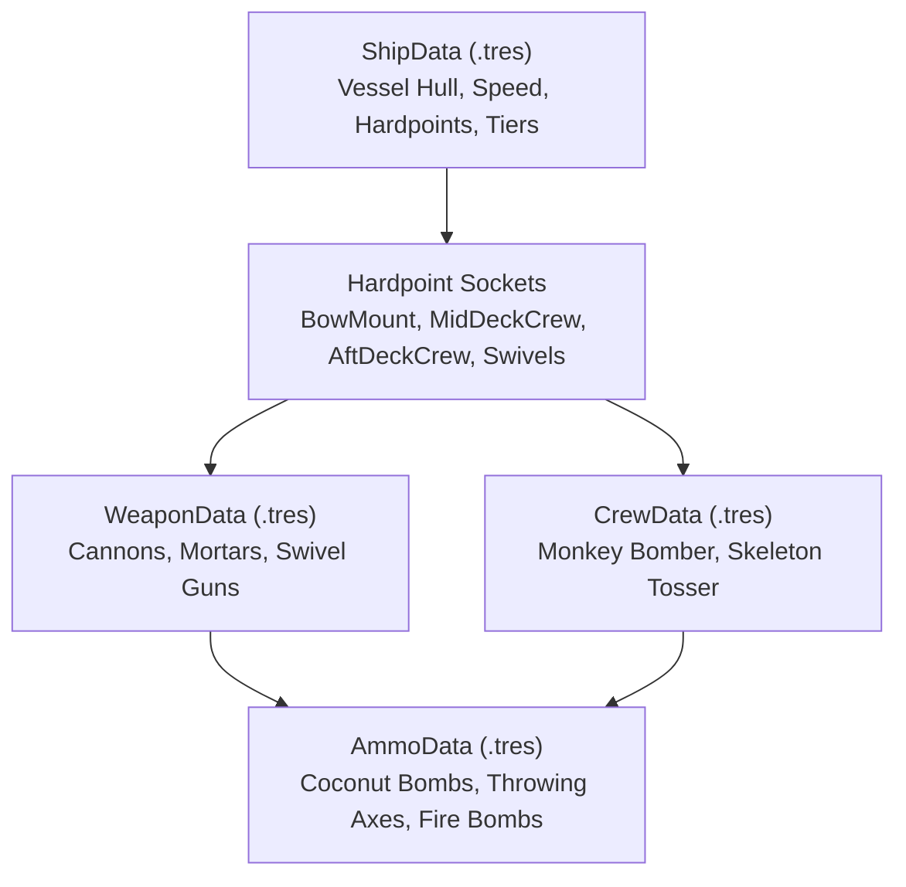

# Cove Corsair - Vessel, Crew & Weapon Customization Guide

This guide details how to modify and configure player flagships (vessels), deck crew members, weapon hardpoints, and naval ammunition types using Cove Corsair's data-driven resource architecture.

---

## 🧭 1. System Architecture

Player combat power and vessel attributes are governed by four modular Godot `Resource` classes:



All user assets live under `src/data/resources/`:
- `user_vessels/` — Ship resources ([ShipData](file:///f:/projects/cove-corsair/src/data/ship_data.gd)).
- `user_crew/` — Crew companion resources ([CrewData](file:///f:/projects/cove-corsair/src/data/crew_data.gd)).
- `user_weapons/` — Fixed socket weapons ([WeaponData](file:///f:/projects/cove-corsair/src/data/weapon_data.gd)).
- `user_ammo/` — Ammunition projectiles & sprites ([AmmoData](file:///f:/projects/cove-corsair/src/data/ammo_data.gd)).

---

## ⛵ 2. Modifying User Vessels (`ShipData`)

Vessel files reside in `src/data/resources/user_vessels/`:
- [dinghy_ship.tres](file:///f:/projects/cove-corsair/src/data/resources/user_vessels/dinghy_ship.tres) — Agile slalom craft.
- [sloop_ship.tres](file:///f:/projects/cove-corsair/src/data/resources/user_vessels/sloop_ship.tres) — Balanced twin-cannon flagship.
- [bombard_skiff_ship.tres](file:///f:/projects/cove-corsair/src/data/resources/user_vessels/bombard_skiff_ship.tres) — Heavy mortar siege skiff.
- [ironclad_ship.tres](file:///f:/projects/cove-corsair/src/data/resources/user_vessels/ironclad_ship.tres) — Armored 3-stream brawler.

### Vessel Configuration Fields

| Property | Type | Default | Description |
| :--- | :--- | :--- | :--- |
| `ship_id` | `String` | `"sloop"` | Machine identifier matching `GameState.VESSEL_CATALOG`. |
| `ship_name` | `String` | `"The Sloop"` | In-game display name. |
| `max_health` | `int` | `1` – `8` | Maximum hull hit points. |
| `move_speed` | `float` | `7.5` – `12.0` | Lateral steering/strafing speed ($m/s$). |
| `fire_rate` | `float` | `0.15` – `1.30` | Cooldown delay between primary cannon volleys (seconds). |
| `base_cannons` | `int` | `1` – `3` | Parallel cannon firing streams. |
| `collision_size` | `Vector3` | `(1.4, 1.0, 2.5)` | Size of the player vessel's bounding box. |
| `model_scene` | `PackedScene` | `the_sloop.glb` | 3D visual mesh loaded from `assets/models/user/vessels/`. |
| `sprite_texture` | `Texture2D` | `The Sloop.png` | 2D preview texture loaded from `assets/sprites/user_vessels/`. |
| `y_offset` | `float` | `0.33` | Vertical placement to ensure waterline float height. |
| `scale` | `Vector3` | `Vector3(2.0, 2.0, 2.0)` | Visual scale applied to the 3D model. |

### Hardpoint Sockets & 3-Tier Upgrades
Each vessel defines socket locations for mounted crew and weapons:
- `hardpoint_offsets`: Dictionary mapping socket names to `Vector3` local coordinates.
  ```gdscript
  hardpoint_offsets = {
      "BowMount": Vector3(0, 0.92, -1.55),
      "MidDeckCrew": Vector3(-0.26, 0.62, 0.57),
      "AftDeckCrew": Vector3(0.26, 0.77, 0.73),
      "PortSwivelMount": Vector3(-0.32, 0.61, -0.79),
      "StarboardSwivelMount": Vector3(0.31, 0.63, -0.76)
  }
  ```
- `upgrade_costs`: Array of doubloon upgrade costs `[Tier 1, Tier 2, Tier 3]` (e.g. `[0, 800, 1500]`).
- `tier_descriptions`: Array of summary strings shown in the Shipyard UI.
- `tier_sockets`: Array of string arrays determining which sockets are active at each tier:
  ```gdscript
  tier_sockets = [
      ["BowMount"],
      ["BowMount", "MidDeckCrew", "AftDeckCrew"],
      ["BowMount", "MidDeckCrew", "AftDeckCrew", "PortSwivelMount", "StarboardSwivelMount"]
  ]
  ```

---

## 🐒 3. Modifying User Crew (`CrewData`)

Crew members inherit from [CrewData](file:///f:/projects/cove-corsair/src/data/crew_data.gd), which extends [WeaponData](file:///f:/projects/cove-corsair/src/data/weapon_data.gd). When mounted to a deck socket, [AttachedWeapon](file:///f:/projects/cove-corsair/src/gameplay/player/attached_weapon.gd) loads their 3D animated model, scans for targets, and throws ballistic projectiles.

### Existing Crew Files (`src/data/resources/user_crew/`)
- [crew_monkey_bomber.tres](file:///f:/projects/cove-corsair/src/data/resources/user_crew/crew_monkey_bomber.tres) — Autonomous coconut bomb thrower.
- [crew_skeleton_tosser.tres](file:///f:/projects/cove-corsair/src/data/resources/user_crew/crew_skeleton_tosser.tres) — Rapid-fire throwing axe skirmisher.

### Crew Tunable Properties

| Property | Type | Default / Options | Purpose |
| :--- | :--- | :--- | :--- |
| `weapon_name` | `String` | `"Monkey Bomber"` | Crew member name. |
| `crew_role` | `String` | `"bomber"`, `"sniper"`, `"tosser"` | Tactical behavior category. |
| `targeting_priority` | `String` | `"nearest"`, `"highest_threat"`, `"boss_focus"` | Target selection rule in range. |
| `detection_range` | `float` | `20.0` | Radius ($m$) within which enemies are acquired. |
| `max_throw_range` | `float` | `20.0` | Maximum reach for ballistic tosses. |
| `throw_arc_height` | `float` | `0.5` – `1.5` | Peak height of the parabolic lob curve. |
| `fire_rate` | `float` | `0.20` – `1.50` | Cooldown period between throws (seconds). |
| `default_ammo` | `AmmoData` | `ammo_coconut_bomb.tres` | Primary projectile thrown. |
| `compatible_ammo` | `Array[Resource]` | Array of `AmmoData` | Other ammo types this crew can equip. |
| `sprite_texture` | `Texture2D` | Preview texture | 2D UI portrait / HUD sprite. |

---

## 💣 4. Modifying Ammo & Projectile Sprites (`AmmoData`)

All naval and crew projectiles reference [AmmoData](file:///f:/projects/cove-corsair/src/data/ammo_data.gd).

### Existing Ammo Files (`src/data/resources/user_ammo/`)
- [ammo_standard_ball.tres](file:///f:/projects/cove-corsair/src/data/resources/user_ammo/ammo_standard_ball.tres) — Standard 1-damage cast iron cannonball.
- [ammo_coconut_bomb.tres](file:///f:/projects/cove-corsair/src/data/resources/user_ammo/ammo_coconut_bomb.tres) — High-damage explosive coconut ($3\text{ DMG}, 2.5\text{m AoE}$).
- [ammo_fire_bomb.tres](file:///f:/projects/cove-corsair/src/data/resources/user_ammo/ammo_fire_bomb.tres) — Blazing incendiary explosive ($4\text{ DMG}, 3.0\text{m AoE}$).
- [ammo_heavy_shot.tres](file:///f:/projects/cove-corsair/src/data/resources/user_ammo/ammo_heavy_shot.tres) — High-penetration heavy iron shot ($5\text{ DMG}$).
- [ammo_throwing_axe.tres](file:///f:/projects/cove-corsair/src/data/resources/user_ammo/ammo_throwing_axe.tres) — Rapid-spinning axe projectile ($2\text{ DMG}$, end-over-end tumble).
- [ammo_scatter_pellet.tres](file:///f:/projects/cove-corsair/src/data/resources/user_ammo/ammo_scatter_pellet.tres) — Wide-cone pellet for blunderbuss/swivel weapons.

### Tunable Ammo Properties

| Property | Type | Default | Description |
| :--- | :--- | :--- | :--- |
| `ammo_name` | `String` | `"Coconut Bomb"` | Display name of ammunition. |
| `damage` | `int` | `1` – `5` | Direct impact damage to targets. |
| `aoe_damage` | `int` | `0` | Radial splash damage (defaults to `damage` if `0`). |
| `splash_radius` | `float` | `0.0` – `3.5` | Blast radius in meters ($0.0 = \text{single target}$). |
| `projectile_speed` | `float` | `18.0` – `28.0` | Velocity moving down-track. |
| `sprite_texture` | `Texture2D` | `ammo_coconut_bomb.png` | **Custom 2D sprite visual for the projectile.** |
| `scale_multiplier` | `float` | `1.0` – `2.0` | Scale factor applied to the visual in-flight. |
| `pixel_size` | `float` | `0.005` | Billboarding resolution scale. |
| `spins_in_flight` | `bool` | `false` / `true` | Rotates end-over-end (360° spin) along trajectory. |
| `arc_height_bonus`| `float` | `0.0` | Additional height added to ballistic arc. |

### How Projectile Sprites Work Automatically in [cannonball.gd](file:///f:/projects/cove-corsair/src/gameplay/projectiles/cannonball.gd)
When a projectile fires, [cannonball.gd](file:///f:/projects/cove-corsair/src/gameplay/projectiles/cannonball.gd#L252-L260) inspects the assigned `AmmoData`:
1. If `sprite_texture` is present:
   - The default 3D cast-iron sphere mesh is hidden (`model.visible = false`).
   - A `Sprite3D` billboard is instantiated and assigned your custom PNG texture.
   - Scale, offsets, and tumble rotations (`spins_in_flight`) are applied automatically.
2. If `sprite_texture` is `null`:
   - It renders the authentic 3D metallic iron sphere with calibrated material roughness.

---

## 🛠️ 5. Step-by-Step Customization Recipes

### Recipe 1: Make a High-Speed Glass Cannon Vessel
1. Open `res://src/data/resources/user_vessels/sloop_ship.tres`.
2. Set `max_health = 2`.
3. Set `move_speed = 13.5`.
4. Set `fire_rate = 0.10`.
5. Save. The Sloop will now steer at extreme speeds and fire rapid bursts at the cost of low survivability.

### Recipe 2: Create an Explosive Pineapple Ammo Type
1. Place `pineapple_bomb.png` in `assets/sprites/ammo/`.
2. Right click in `res://src/data/resources/user_ammo/` > **Create New Resource** > **AmmoData**.
3. Set:
   - `ammo_name`: `"Pineapple Bomb"`
   - `damage`: `4`
   - `splash_radius`: `3.0`
   - `projectile_speed`: `20.0`
   - `sprite_texture`: `res://assets/sprites/ammo/pineapple_bomb.png`
   - `scale_multiplier`: `1.5`
4. Save as `ammo_pineapple_bomb.tres`.
5. Open `crew_monkey_bomber.tres` and assign `ammo_pineapple_bomb.tres` to `default_ammo`.
